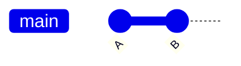
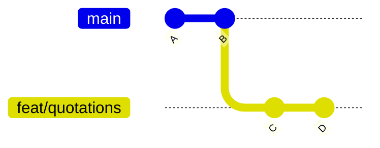
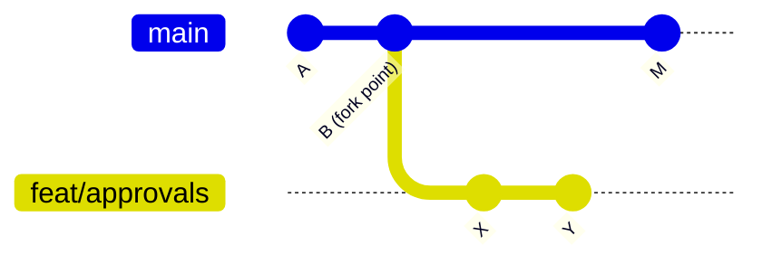
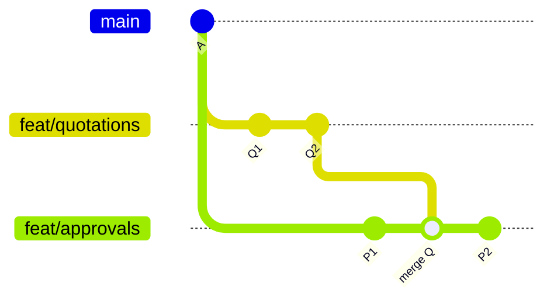
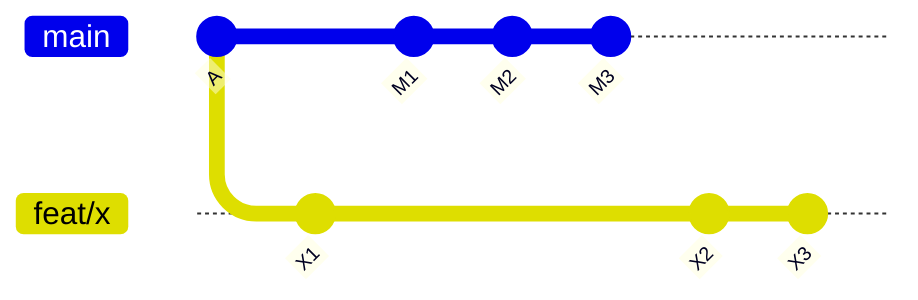
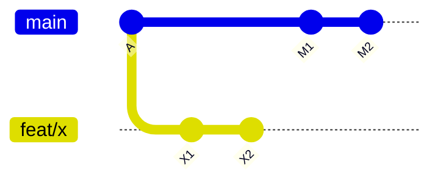
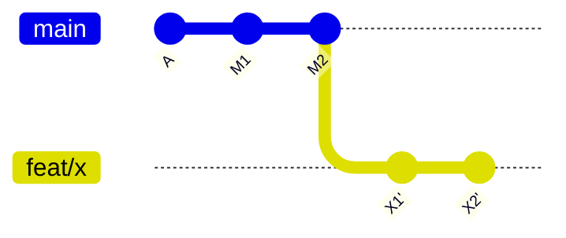
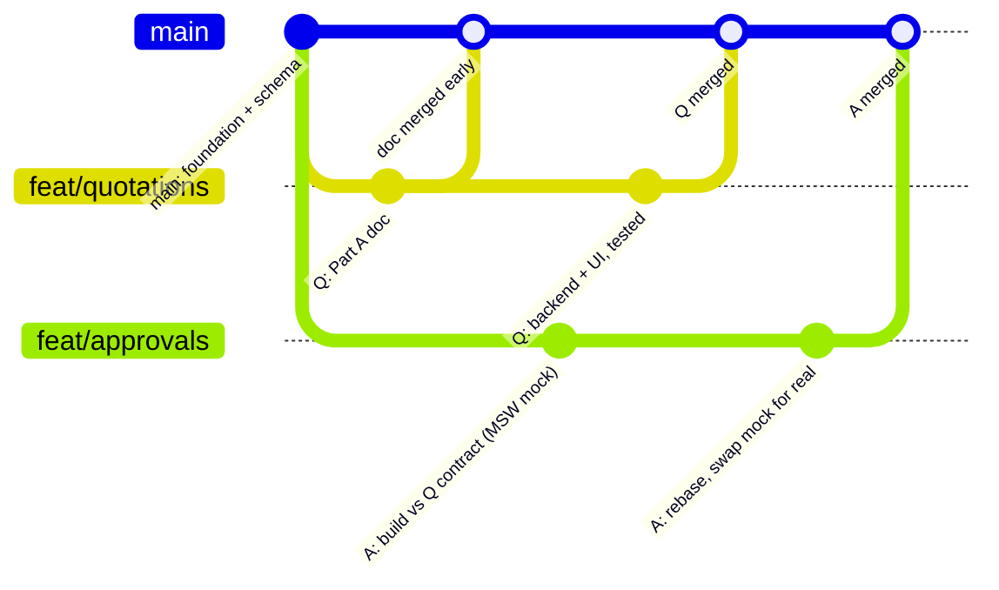

# Git concepts behind TEAM-SYNC.md

This guide explains the git ideas in `.cursor/skills/build-feature/TEAM-SYNC.md`. Three developers work on three features at the same time. Git is how they stay out of each other's way.

The whole policy comes down to one rule: **build only on `origin/main`, and keep your own work on your own branch.** Everything else in the file follows from that.

---

## 1. Repository, commit, branch

A **repository** is the project folder plus its full history. A **commit** is one saved snapshot of the files, with a message and a pointer to the commit before it. A **branch** is a movable label that points at one commit. When you commit on a branch, the label moves forward to your new commit.



`main` is the branch that holds finished, tested work. It is the team's shared source of truth.

A **feature branch** is a label you create off `main` to do your own work without touching `main`. TEAM-SYNC names them `feat/<feature>`, for example `feat/quotations`.



Commits C and D exist only on `feat/quotations`. `main` has not moved.

Each teammate has one of these. Three people, three branches, no interference.

---

## 2. Local vs remote, and what `origin` means

Your laptop has its own copy of the repository. The shared server (GitHub, Origin, and so on) has another. The server copy is called a **remote**, and the default name for it is `origin`.

Branches live in both places, so git writes them differently:

| Name | Meaning |
| :--- | :--- |
| `main` | Your local `main`. You can change it. |
| `origin/main` | Your laptop's last known copy of the server's `main`. You cannot commit to it directly. It updates only when you `fetch`. |
| `origin/feat/quotations` | Your laptop's last known copy of a teammate's pushed branch. |

`origin/main` can be stale. If a teammate merged something ten minutes ago, you will not see it until you fetch. That is why the first command in TEAM-SYNC is a fetch.

---

## 3. The discovery commands

```bash
git fetch --all --prune
git branch -r
git ls-tree -r --name-only origin/main | rg "features/|docs/features/"
git diff --stat origin/main...origin/<teammate-branch> -- docs/features apps/backend/src/features
```

### `git fetch --all --prune`

Downloads new commits and branch labels from the server. It **does not change your files or your current branch**. It only updates the `origin/...` labels. That makes it safe to run at any time.

- `--all` fetches from every remote, not just `origin`.
- `--prune` deletes your local `origin/...` labels for branches that were deleted on the server. Without it you would see dead branches for merged features.

Compare with `git pull`, which is `fetch` plus an automatic merge (or rebase) into your current branch. That one does change your files.

### `git branch -r`

Lists remote branches (`-r`). This is how you see who is working on what, because every teammate's branch is named `feat/<feature>`. A branch called `origin/feat/approvals` means someone has claimed Approvals.

### `git ls-tree -r --name-only origin/main`

Prints the file paths that exist on `origin/main`. Notice that you are asking about a branch, not your working folder. Git can show you any commit's files without checking it out.

- `-r` goes into subfolders.
- `--name-only` prints paths only.
- The `| rg "features/|docs/features/"` part filters the list to feature files.

A feature doc in `docs/features/` on `origin/main` means that feature has been claimed and its contract is published.

### `git diff --stat origin/main...origin/<teammate-branch> -- <paths>`

Shows what a teammate's branch changed, as a summary (`--stat` gives file names and line counts instead of full code).

Two details matter here.

**Three dots (`A...B`).** This compares B against the point where B split off from A, so you see only the teammate's own changes. Two dots (`A..B`) would compare the two branch tips directly, and any new commits on `main` would show up as if the teammate had deleted them. Three dots avoids that noise.



`origin/main...origin/feat/approvals` shows X and Y only. M is ignored.

**`-- <paths>`.** Everything after `--` is a path filter. Here it limits the output to the feature docs and backend feature code, so you do not scroll through unrelated files.

---

## 4. Why you never build on a teammate's branch

TEAM-SYNC says: read their branch, but never build on it, merge it, or cherry-pick from it. Here is why.

A teammate's branch is unfinished. Their commits can change shape, get rewritten, or be dropped. Suppose you merge their branch into yours:



Now your history contains Q1 and Q2. If the Quotations owner rewrites Q1 (an amend, a rebase, a different design), your branch still has the old copy. When both land on `main`, git sees the same change twice in two forms. You get conflicts you did not cause and cannot easily explain.

**Cherry-pick** copies a single commit onto your branch as a new commit with a different ID. It has the same problem. Git no longer knows that your copy and the original are the same change, so a later merge can conflict or duplicate it.

`origin/main` only changes when someone finishes and tests their part. That makes it a stable base. This is the reason for the three-step dependency order:

1. **Merged on `origin/main`:** rebase onto it and call the real endpoint.
2. **Not merged yet:** build against their written contract (`docs/features/<feature>.md` Part A) using an MSW mock. You depend on a document, not on code that might move.
3. **Neither exists:** ask. Do not guess.

---

## 5. Merging to `main` early and often

A **merge** brings one branch's commits into another. Merging a feature into `main` is how finished work becomes available to everyone.

TEAM-SYNC pushes hard for **small, early merges**. The reason is that the longer a branch lives, the further it drifts from `main`, and the larger the conflict pile when you finally merge.



Three commits on `main` that your branch has never seen. Each could touch a file you also touched.

Two ordering rules come from the same idea:

- **Foundation first.** The shared schema goes in before features that use it. Otherwise two people invent the same table differently.
- **Producers before consumers.** Merge Quotations before Approvals, because Approvals reads quotation data. The consumer can then switch from a mock to the real endpoint with no guessing.

Merging early also explains why step 2 of the workflow says to push `docs/features/<feature>.md` Part A **on its own** as soon as it is approved. A document is a tiny, safe commit. Teammates get your API contract days before your code is done.

---

## 6. Rebase, and why it comes before every merge

**Rebase** moves your branch's commits so they start from a newer base. Compare it with merge:

- **Merge** ties two histories together with an extra merge commit.
- **Rebase** replays your commits, one by one, on top of the latest `main`. The result is a straight line.

Before:



After `git rebase origin/main` on `feat/x`:



X1' and X2' are the same changes with new IDs, because their parent changed. Your branch now looks as if you had started after M2.

Why TEAM-SYNC wants this:

- You find conflicts **on your branch**, while you still have context, instead of at merge time.
- You test your feature against the real current `main`, so "it works on my branch" actually means something.
- `main` stays a readable straight history.

Related commands in the file:

```bash
git pull --rebase origin main
```

This is `fetch` followed by a rebase of your current branch onto `origin/main`. Use it before touching a hot file.

**Rebase rewrites your commits' IDs.** That is safe on your own private branch. It is dangerous on a branch other people have built on. That leads to the next section.

---

## 7. Force-push and why `main` is off limits

A normal `git push` only adds commits. The server refuses it if it would lose history, which protects teammates.

A **force-push** (`git push --force`) tells the server to move the branch label wherever you say, even if that discards commits. After a rebase, your local branch has new commit IDs, so pushing it to a branch you pushed before needs a force.

- Force-pushing **your own** `feat/<feature>` branch is routine after a rebase, since only you use it.
- Force-pushing **`main`** deletes whatever others merged after your base. Everyone's clone then disagrees with the server. The rule is: never.

If you must force-push your own branch, prefer `git push --force-with-lease`. It refuses if someone else pushed to the branch since you last fetched, so you do not overwrite them by accident.

---

## 8. Conflicts, and "keep both sides' lines"

A **conflict** happens when two branches change the same lines of the same file, and git cannot decide which version wins. Git stops and marks the file:

```text
<<<<<<< HEAD
import { quotationsRoutes } from "./features/quotations";
=======
import { approvalsRoutes } from "./features/approvals";
>>>>>>> feat/approvals
```

Between `<<<<<<<` and `=======` is one side. Between `=======` and `>>>>>>>` is the other.

The **hot files** table exists because some files are touched by everyone. `app.ts`, `schema/index.ts`, and `feature-registry.tsx` all need one new line per feature. If each person only **appends one line**, conflicts happen, but they are trivial. Both lines are wanted, so the fix is to keep both:

```text
import { quotationsRoutes } from "./features/quotations";
import { approvalsRoutes } from "./features/approvals";
```

Then delete the three marker lines, `git add` the file, and continue the rebase (`git rebase --continue`).

Why each hot-file rule exists:

| Rule | Reason |
| :--- | :--- |
| Append one line only | Two appends at the same spot conflict in an obvious, easy way. A reorder or reformat conflicts in confusing ways. |
| Commit the hot-file edit on its own | If it conflicts, you resolve a one-line commit, not a mixed one. It is also easy to revert. |
| Announce it | Teammates know to rebase soon, so their next merge is smaller. |
| `package.json` and `pnpm-lock.yaml`: merge alone and first | The lockfile is generated. It cannot be merged by hand. Two people changing it produce unresolvable conflicts. One person merges first and everyone else regenerates. |
| Don't edit `test-backend-e2e.mjs`; use `tests/<feature>.e2e.mjs` | Separate files cannot conflict. A shared file will. |
| Edit only your rows in `MOCK_INVENTORY.md` | Different rows are different lines, so git merges them automatically. |

The same pattern repeats everywhere. **Give each person their own files. Where files must be shared, make each edit tiny and separate.**

---

## 9. Commit hygiene

- **Branch `feat/<feature>`.** The prefix makes `git branch -r` self-explanatory.
- **Small commits touching only your folders.** Small commits are easy to review, revert, and rebase. Because they touch only your feature folders, they cannot collide with teammates.
- **Never commit `.env` files.** Once a secret is in git history, it stays there even if you delete the file in the next commit. Anyone with the repo can read it. Rotate the secret if this ever happens.
- **Do not commit or push unless the developer asks.** This is an instruction for the AI agent. Commits are the developer's decision.

---

## 10. The whole workflow in one picture



Reading it left to right:

1. The foundation lands on `main`.
2. Quotations publishes its contract doc and merges it right away.
3. Approvals builds against that contract with a mock. It never touches the Quotations branch.
4. Quotations finishes, passes tests in real mode, and merges.
5. Approvals rebases onto the new `main`, swaps the mock for the real endpoint, and merges.

---

## Command cheat sheet

| Command | What it does | Changes your files? |
| :--- | :--- | :--- |
| `git fetch --all --prune` | Updates `origin/...` labels, removes dead ones | No |
| `git branch -r` | Lists remote branches | No |
| `git ls-tree -r --name-only <ref>` | Lists files at a commit or branch | No |
| `git diff --stat A...B` | Summarises what B changed since it split from A | No |
| `git pull --rebase origin main` | Fetch, then replay your commits on top of `origin/main` | Yes |
| `git rebase origin/main` | Replay your commits on top of the local copy of `origin/main` | Yes |
| `git push --force-with-lease` | Overwrite your own remote branch after a rebase, safely | Remote only |

## Terms

- **Branch:** a movable label pointing at a commit.
- **Remote / `origin`:** the shared server copy of the repo.
- **`origin/main`:** your laptop's last-known copy of the server's `main`.
- **Fetch:** download updates without touching your work.
- **Merge:** combine two branches, usually adding a merge commit.
- **Rebase:** replay your commits on top of a newer base.
- **Cherry-pick:** copy one commit onto another branch as a new commit.
- **Force-push:** overwrite a remote branch even if history is lost.
- **Conflict:** two edits to the same lines that git cannot combine on its own.
- **Hot file:** a file every feature has to touch, so edits to it are kept tiny and separate.
